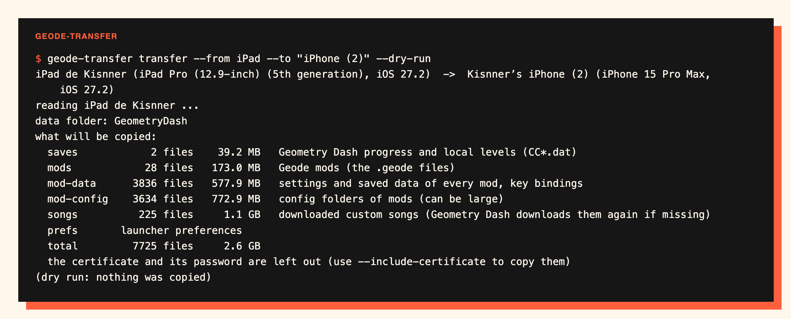
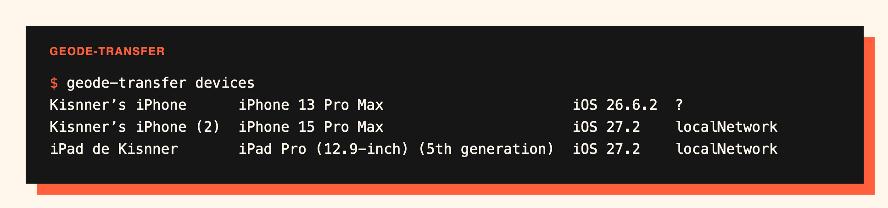
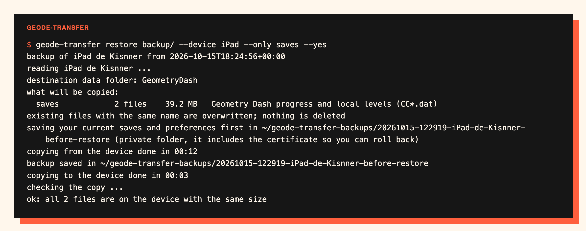

# geode-transfer

move your geode data between iphones and ipads: saves, mods, mod settings and launcher preferences, over usb or wi-fi, checking every file.



## why

geode's ios launcher keeps everything inside its own data folder and has no export. changing device means losing your progress, your mods and their settings, or copying thousands of small files by hand. this tool does it with one command and verifies the result.

## quick start

```sh
git clone https://github.com/kisnner26/geode-transfer
cd geode-transfer
python3 geode_transfer.py devices
python3 geode_transfer.py transfer --from "iPad" --to "iPhone" --dry-run   # see the plan
python3 geode_transfer.py transfer --from "iPad" --to "iPhone"
```

or install it: `pip install .` gives you the `geode-transfer` command.



## what you need

- a mac with xcode 15 or newer (it uses `xcrun devicectl`) and python 3.9 or newer, no other dependencies
- both devices paired with the mac, unlocked, with developer mode on
- geode installed on both with a **development profile** (xcode, altstore, sidestore). apps from the app store or trollstore can't be read by `devicectl`, and `geode-transfer apps` tells you if yours can
- geode **closed** on both devices, and geometry dash installed on the target (geode patches it from there)

## what gets copied

| category | what it is |
|---|---|
| `saves` | geometry dash progress and local levels (`CC*.dat`) |
| `mods` | your `.geode` files |
| `mod-data` | settings and saved data of every mod, key bindings |
| `mod-config` | config folders of mods (can be large) |
| `songs` | downloaded custom songs (geometry dash downloads them again if missing) |
| `prefs` | geode launcher preferences |

choose with `--only saves,mods` or leave things out with `--skip songs,mod-config`. everything is copied by default.

not copied on purpose: the patched copy of geometry dash, the folders geode regenerates (`unzipped`, `resources`, `logs`) and tweaks. after a transfer, geode patches geometry dash again on the first launch, which takes a while.

## safe by default

- **the certificate stays out.** your imported signing certificate and its password live in the launcher preferences. they are not copied unless you pass `--include-certificate`; without them, geode asks for the certificate again on the new device.
- **it refuses to run while geode is open** on the target, so it can't overwrite saves the game is using.
- **it saves the target first.** before writing, it keeps the target's current saves and preferences in `~/geode-transfer-backups/` (a private folder, so you can roll back). that backup includes the certificate; delete it when you no longer need it.
- **it checks the result.** after copying, it lists the target and confirms every file is there with the same size.
- **it never deletes.** files with the same name are overwritten, everything else stays.



## commands

| command | what it does |
|---|---|
| `devices` | list connected iphones and ipads (`--udid` also shows their ids) |
| `apps --device X` | show geode on a device and whether its data is readable |
| `backup --device X --out DIR` | save the data to a folder on your mac |
| `restore DIR --device Y` | write a backup into a device |
| `transfer --from X --to Y` | backup and restore in one step |

devices are matched by name, so `--device iPad` is enough. common options: `--only`, `--skip`, `--dry-run`, `--yes`, `--jobs N`, `--include-certificate`. run any command with `--help`.

## troubleshooting

- **`the device is locked` or `no devices`**: unlock it, keep the screen on and use a cable the first time. the first call can take around twenty seconds while the connection opens.
- **`data is not readable`**: geode was installed without a development profile. reinstall it with xcode, altstore or sidestore.
- **`Geode is open`**: close it completely. if it still says so, the process is still alive: force quit it, or end it with `xcrun devicectl device process terminate --device <id> --pid <pid>`. `--force` skips the check, but then saves the game has open may be overwritten.
- **a developer disk image error**: open xcode > window > devices and simulators once so it prepares the device.

## how it works

everything goes through `xcrun devicectl device copy` on the app data container of the geode launcher, which is readable because the app is signed for development. the tool reads the file listing, groups the paths into the categories above, copies whole folders in parallel with retries, cleans the preferences, writes a `manifest.json` next to the backup and verifies the target against it.

## tested

on macos 27.2 with xcode 27, an ipad pro (ipados 27.2) and an iphone 15 pro max, geode 1.5.5. verified on real devices: listing devices and apps, the dry run of a full transfer, a backup of the saves, the preference cleaning, the refusal to run while geode was open, and a restore of the saves with verification. the unit tests cover categories, preference cleaning, device matching and verification (`python3 -m unittest discover -s tests`). a complete transfer of every category with the tool was not run end to end. back up what matters first.

not affiliated with geode sdk or robtop games. you need to own geometry dash. use at your own risk.

mit license.
